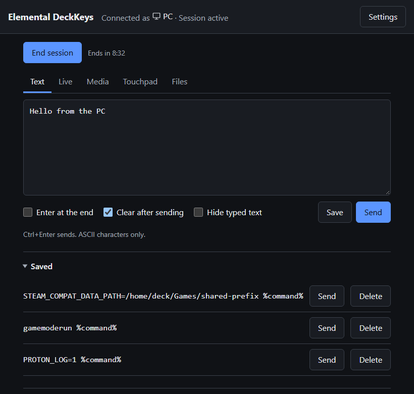
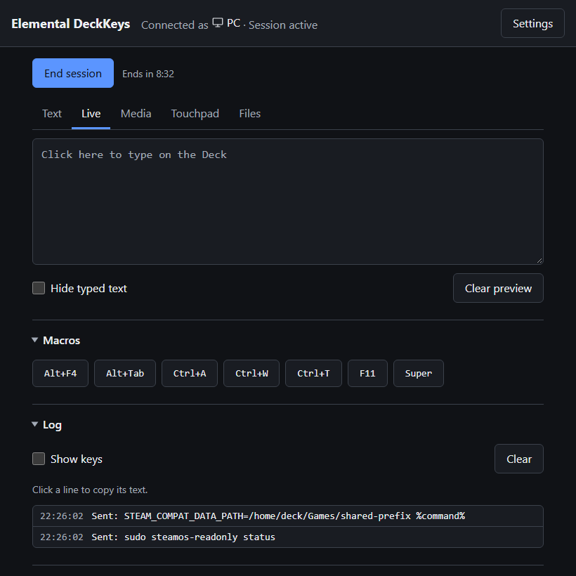
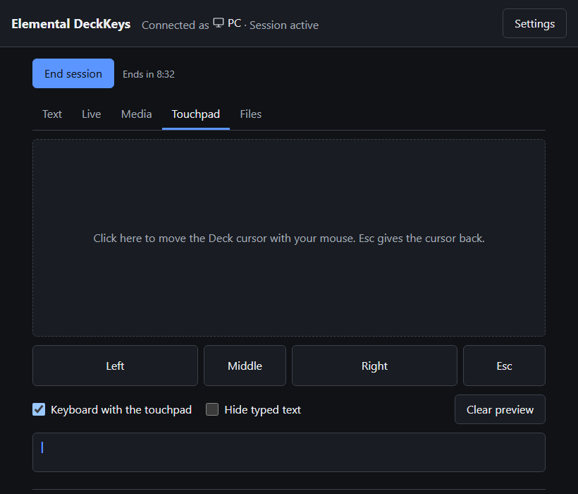
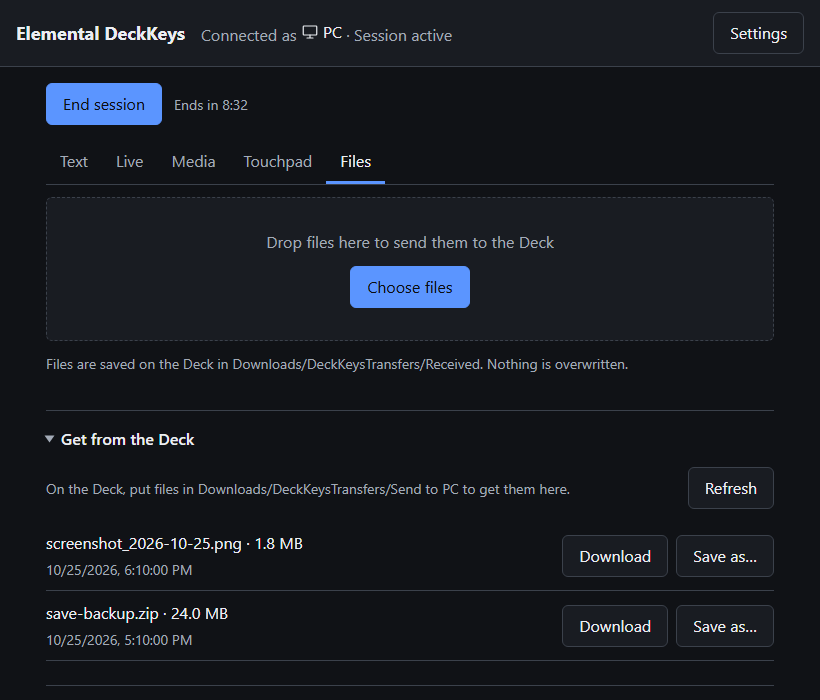
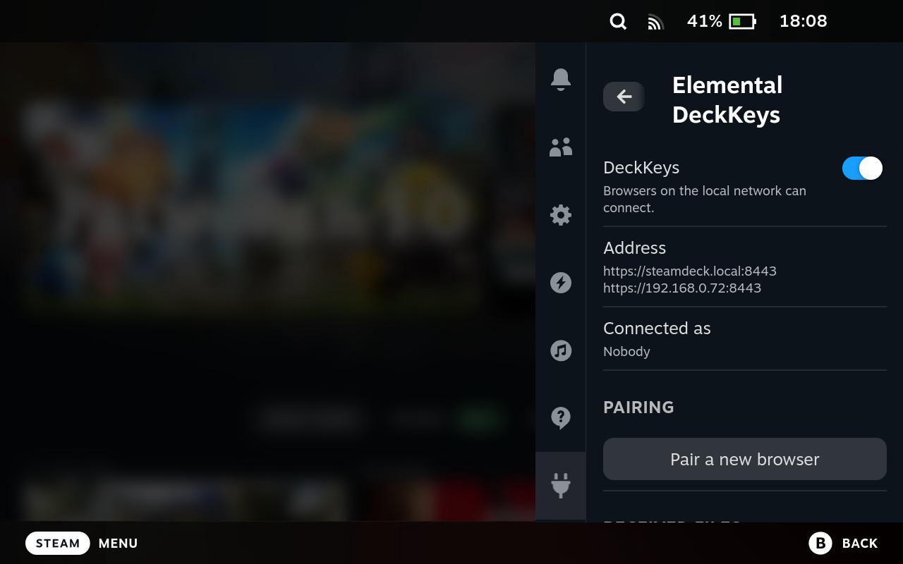
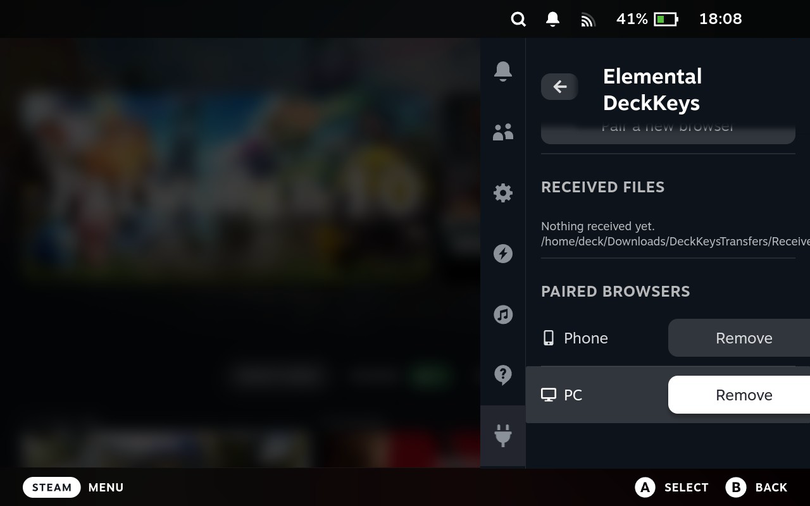

# Elemental DeckKeys

**English** | [Polski](README.pl.md)

Control your Steam Deck from the browser on your PC or phone, over the local network:
type text, use the keyboard live, move the cursor, press media keys and move files.
Works in Game Mode and Desktop Mode. Nothing to plug in, no SSH, nothing to install on the PC.

<table>
  <tr>
    <td></td>
    <td></td>
  </tr>
  <tr>
    <td></td>
    <td></td>
  </tr>
  <tr>
    <td></td>
    <td></td>
  </tr>
</table>

## What it does

| Tab | What for |
|---|---|
| **Text** | Type or paste text and send it to the Deck in one go, optionally with Enter. Save snippets you use often, such as launch options. |
| **Live** | Your keyboard types on the Deck as you press keys. Ctrl+V types the PC clipboard. Macros for shortcuts the browser keeps for itself (Alt+F4, Alt+Tab, Ctrl+W, Ctrl+T, Ctrl+A, F11, Super). |
| **Media** | Play/pause, previous, next, stop, volume and mute. |
| **Touchpad** | On a PC the page takes your mouse (and, if you want, your keyboard) until you press Esc. On a phone the box works like a laptop touchpad. |
| **Files** | Send files to `Downloads/DeckKeysTransfers/Received` on the Deck. Download what you put in `Downloads/DeckKeysTransfers/Send to PC` (with “Save as…” in Chrome and Edge). |

Also: a log of what was sent (click a line to copy it), “Hide typed text” for passwords,
light and dark theme, English and Polish, and a layout for phones in both orientations.

## Install

In Konsole on the Deck (or send the line from another device once DeckKeys runs):

```
curl -L https://github.com/Koutasora/Elemental-DeckKeys/releases/latest/download/Elemental-DeckKeys.tar.gz | tar xz -C /tmp && sudo bash /tmp/Elemental-DeckKeys/files/install.sh
```

Or download `Elemental-DeckKeys.zip` from the [latest release](https://github.com/Koutasora/Elemental-DeckKeys/releases/latest), unpack it on the Deck and double-click `Install Elemental DeckKeys.desktop`
in Dolphin. Either way you enter the `sudo` password once.

- The service starts with the Deck from then on, in Game Mode and Desktop Mode.
- If no browser is paired yet, the installer shows a pairing code right away.
- If Decky Loader is installed, it asks whether to add the Game Mode panel (no by default).
- Running the same command again updates DeckKeys. Pairing is kept and open pages reload by themselves.

## Pair a browser or a phone

1. On the Deck: the Decky panel > **Pair a new browser**, or the application menu >
   **Elemental DeckKeys – Pair** (no password). It shows the address, a 6-digit code valid
   for 2 minutes and a QR code with the address for phones.
2. Open `https://steamdeck.local:8443` (on phones use the IP address shown, or scan the QR code).
   Accept the certificate warning once: the Deck issues its own certificate.
3. Enter the code and choose the device: PC, Mac, Phone or Other.

## Use

1. **Start session.** The button is green when you can start, blue during a session and red when
   there is no connection. The virtual keyboard and mouse exist only during a session.
2. Pick a tab and go. In Game Mode, select text fields with the arrow keys and Enter: touching them
   opens Steam's on-screen keyboard.
3. The session ends with **End session**, by closing the page, or after 10 minutes without typing
   (5 to 30 minutes in Settings).

On the Deck, without a password:

- **Decky panel** (Game Mode): on/off switch, who is connected, pairing with the QR code,
  paired browsers, received files.
- **Application menu** (Desktop Mode): Elemental DeckKeys – Pair, On/Off, Uninstall.

## Security

- Local network only. Encrypted (HTTPS with the Deck's own certificate).
- A browser can connect only after it was paired with a code from the Deck. The Deck stores
  only a hash of each browser's key; paired browsers can be removed in the Decky panel.
- Keys, mouse and files work only during a session started from that browser.
- The service can press keys and move the mouse, and read or write files only in
  `Downloads/DeckKeysTransfers`. It never runs commands.
- Off (Decky panel or application menu): nothing on the network can connect.

## Uninstall

Application menu > **Elemental DeckKeys – Uninstall** (asks for the `sudo` password).
It removes the service, the panel, the certificate and the paired browsers. Files in
`Downloads/DeckKeysTransfers` stay.

## For developers

- `deck/` – what goes to the Deck: the installer and `files/` (Python, standard library only).
- `decky-plugin/` – source of the Decky panel. `npm install` and `npm run build` there build it
  into `deck/files/decky/`.
- The newest code from `main` (not a release), for testing:

  ```
  curl -L https://github.com/Koutasora/Elemental-DeckKeys/archive/refs/heads/main.tar.gz | tar xz -C /tmp && sudo bash /tmp/Elemental-DeckKeys-main/deck/files/install.sh
  ```
- [SPEC.md](SPEC.md) – how it works and why.

## License

[MIT](LICENSE)
